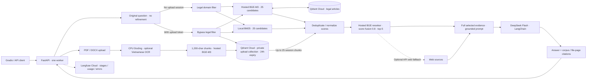

# **Legal RAG Vietnamese Chatbot** 🏛️⚖️

A Retrieval-Augmented Generation (RAG) system designed to answer legal questions in Vietnamese, using hybrid retrieval, BGE-M3 embeddings, BGE reranking, and DeepSeek generation over Vietnamese legal documents and session-private uploads.

[](LICENSE)
[](https://python.org)


## **Features**

- **Hybrid RAG Architecture** - Combines BGE-M3 dense retrieval with local BM25 keyword search over 61,068 articles.
- **Original-Query Retrieval** - Uses the user's question directly; query refinement is disabled to avoid introducing unsupported article references.
- **Top-5 Evidence** - Retrieves 25 sparse and 25 dense candidates, deduplicates them, and selects five sources after BGE reranking and score fusion.
- **Hosted Models** - Uses DeepSeek Flash through `langchain-deepseek`, hosted BGE-M3 embeddings, and hosted BGE reranking to reduce laptop inference work. Local Ollama/Qwen and local retrieval models remain selectable alternatives.
- **Private Document Uploads** - Adds PDF/DOCX sources through Docling, with filename/page citations, session isolation and automatic 24-hour expiry.
- **Vietnamese OCR** - Optionally re-reads scanned PDFs or broken selectable text using full-page Tesseract OCR. Processing and completion messages remain visible. See [upload limits and setup](docs/document-uploads.md).
- **FastAPI + Gradio** - Serves questions and uploads through a validated HTTP API and password-protected chat UI.
- **Docker + Qdrant Cloud** - Packages API/UI separately and keeps legal vectors and temporary uploads in Cloud collections. Local Qdrant remains supported.
- **Langfuse Cloud Tracing** - Optionally records retrieval, reranking, generation, model usage, errors and conversation sessions.
- **Optional Web Fallback** - Available through the API; disabled by default and in Gradio.

The current demo runs from **main**, with hosted models and Qdrant Cloud. `.env.example` selects hosted providers; without explicit provider settings, code defaults retain the local baseline. See [hosted provider configuration and indexing](docs/hosted-retrieval.md).

## **Dataset**

The dataset is from [[Zalo-AI-2021] Legal Text Retrieval](https://www.kaggle.com/datasets/hariwh0/zaloai2021-legal-text-retrieval/data). Download and prepare it automatically:

```bash
python download_dataset.py
```

The download contains **3,271 legal documents**, **61,425 articles** (**61,068 with nonempty text**), **3,196 labeled training questions**, and **511 public-test questions**. The script prepares the layout below and writes `data/dataset_manifest.json` with counts and the source archive SHA-256. Dataset files, indexes, and raw results are excluded from Git.

```bash
├── data/
│   ├── train/
│   │   ├── train_question_answer.json
│   │   └── train_qna.csv
│   ├── test/
│   │   ├── public_test_question.json
│   │   └── public_test_sample_submission.json
│   ├── corpus/
│   │   ├── legal_corpus_legend.csv
│   │   ├── legal_corpus_splitted.csv
│   │   ├── legal_corpus_original.csv
│   │   ├── legal_corpus_merged_u369.csv
│   │   ├── legal_corpus_merged_u256.csv
│   │   ├── legal_corpus_hashmap.csv
│   │   └── legal_corpus.json
│   └── utils/
│       └── stopwords.txt
```
## **Architecture**

Gradio calls FastAPI, which loads the trusted BM25 index once and connects to hosted providers and Qdrant Cloud. The API serializes answering and document indexing. OCR and BM25 still run on CPU locally; model inference is remote in the hosted deployment.



### Retrieval Layer

- **Vector Store** - Hosted `BAAI/bge-m3`, 1,024 dimensions, cosine search in `hosted_baai_bge_m3_1024`. The demo collection contains 61,068 articles.
- **BM25 Retriever** - Vietnamese preprocessing, `k1=1.2`, `b=0.65`, and a local persistent index.
- **Hybrid Search** - Up to 25 candidates per retriever, merged by article ID using maximum normalized retrieval score. Dense cosine threshold: 0.25.
- **Article-Level Indexing** - One vector per nonempty corpus article with full content and metadata. Provider embedding token limits still apply; corpus articles are not split into upload-sized chunks.
- **Uploaded Sources** - Separate session-filtered collection; adds up to 25 uploaded chunks to the same candidate pool before one combined rerank. Without uploads, the corpus retrieval path is unchanged.

### Reranking and Generation

- **BGE rerank** - Utilizes `BAAI/bge-reranker-v2-m3`.
- **Score Fusion** - Reranker weight 0.8; final top-5 sources for answering.
- **Full Evidence** - Complete selected articles/chunks reach reranking and generation. API/UI excerpts are capped at 2,000 characters; provider token limits still apply.
- **DeepSeek Flash** - Uses `langchain-deepseek`, thinking disabled, output cap 2,048 tokens. Generation and legal-domain classification use the configured provider. Uploaded-document questions bypass the legal filter.
- **Grounded Prompt** - Cites supplied evidence, acknowledges insufficient information, and treats document contents as evidence rather than instructions. Uploaded documents are not automatically verified current law.
- **Local Alternative** - `INFERENCE_PROVIDER=ollama` supports `qwen3.5:9b` through `langchain-ollama`. Local embeddings and reranking are also selectable; preserve the matching collection/model dimensions.

### Document Processing

- **Docling on CPU** - PDF/DOCX extraction; optional full-page Tesseract with Vietnamese/English for scanned PDFs or damaged text layers. DOCX ignores OCR. OCR may misread legal wording and must be checked against the original.
- **Limits** - 10 MiB/file, 50 PDF pages, three files and 300 chunks/session. Normal parsing has a three-minute subprocess limit; OCR allows ten minutes plus cleanup time.
- **Privacy** - Random document capability tokens isolate sessions. Chunks expire after 24 hours; raw API files are removed after conversion. API restarts invalidate upload sessions. Clear chat deletes that session's uploads.

### Serving and Observability

- **FastAPI** - `/ask`, `/documents`, `/health`, `/ready`; validated requests and sanitized errors. Answering/indexing/deletion share one lock; overlapping requests receive HTTP 429.
- **Gradio** - Calls the API, displays source excerpts and upload status, and offers the OCR checkbox. Chat history is displayed, but only the current question is sent to the pipeline.
- **Docker** - Separate API/UI images, CPU-only PyTorch, Tesseract and Vietnamese language data, persistent model/Docling caches. Compose still starts a local Qdrant service; when Cloud credentials are set, application requests use Cloud instead.
- **Langfuse Cloud** - SDK and LangChain callbacks trace classification, retrieval, reranking and generation with model token usage. Upload spans record counts, never document tokens. Content capture can include uploaded evidence; disable it for confidential documents.

## **Results**

Evaluated the hosted BGE-M3/BGE stack on **all 3,196 labeled training questions** from Zalo AI 2021, searching **61,068 articles**. All methods use original questions, exact gold article IDs, up to 25 candidates per enabled retriever, and **final top-5**. Scores are macro averages. The benchmark makes no generation, classification, refinement or web-search calls.

| Method | P@5 | R@5 | F1@5 | Hit@5 | MAP@5 | MRR@5 | nDCG@5 |
|--------|-----|-----|------|-------|-------|-------|--------|
| Sparse Only (BM25) | 0.1430 | 0.7020 | 0.2370 | 0.7093 | 0.5371 | 0.5429 | 0.5800 |
| Dense Only (BGE-M3) | 0.1544 | 0.7567 | 0.2559 | 0.7650 | 0.5885 | 0.5957 | 0.6324 |
| Hybrid (Sparse + Dense) | 0.1609 | 0.7887 | 0.2666 | 0.7963 | 0.5794 | 0.5851 | 0.6338 |
| **Hybrid + BGE Reranking** | **0.1854** | **0.9081** | **0.3071** | **0.9149** | **0.7843** | **0.7906** | **0.8173** |

Hybrid + BGE reaches **90.81% Recall@5**, improving over BM25 by **20.61 percentage points** and hybrid without reranking by **11.94 points**. Compared with the local stack, final Recall@5 rises from **82.36% to 90.81%** (**+8.45 points**), and nDCG@5 rises from **0.7113 to 0.8173** (**+0.1060**). Hit@5 is the fraction of questions with at least one relevant article; MAP uses all unique gold articles as its denominator, and nDCG uses binary relevance.

| Method | Mean Retrieval (s) | P95 Retrieval (s) |
|--------|-------------------|------------------|
| Sparse Only (BM25) | 0.4856 | 0.9370 |
| Dense Only (BGE-M3) | 0.5340 | 0.7470 |
| Hybrid (Sparse + Dense) | 1.0196 | 1.4931 |
| Hybrid + BGE Reranking | 1.6646 | 2.3744 |

*Timings cover retrieval and reranking with hosted services, including their network calls. The 1.6646-second mean is not complete chatbot response time; DeepSeek answer generation is excluded.*

*These are training-set retrieval measurements, not held-out accuracy, generated-answer quality, current-law validity or uploaded-document/OCR evaluation. The previous and current stacks changed embedding models, article truncation and compute/provider locations together; this comparison does not isolate the cause of the gain. Latency is not directly comparable with the earlier Kaggle hardware.*

See the [hosted benchmark and previous-stack comparison](docs/hosted-benchmark-comparison.md) for the full tables, protocol and limitations. Per-question checkpoints and manifests remain locally under `results/hosted-full-article-top5/`; raw results are excluded from Git. Historical [Qwen answer-generation measurements](https://github.com/doremonn2847/Legal-RAG-VN-Chatbot/blob/0951fd2d501e594956dca44dd55620f72e43e237/docs/qwen-full-run-review.md) apply to that earlier model run, not the current DeepSeek deployment.

## **Installation**

### 1. Prepare the environment

```bash
git clone https://github.com/doremonn2847/Legal-RAG-VN-Chatbot.git
cd Legal-RAG-VN-Chatbot
python -m venv .venv
# Windows PowerShell: .\.venv\Scripts\Activate.ps1
# Linux/macOS: source .venv/bin/activate
```

Copy `.env.example` to `.env` **inside the project directory** and supply your private provider keys. Install [Docker Desktop](https://www.docker.com/products/docker-desktop/). For native Python/indexing, install CPU dependencies before the remaining packages:

```bash
pip install torch==2.8.0 torchvision==0.23.0 --index-url https://download.pytorch.org/whl/cpu
pip install -r requirements.txt
```

Docker installs Tesseract with Vietnamese/English data. Native OCR additionally requires Tesseract and its `vie`/`eng` language files on PATH.

```dotenv
INFERENCE_PROVIDER=deepseek
DEEPSEEK_BASE_URL=https://api.deepseek.com
DEEPSEEK_MODEL=deepseek-flash
DEEPSEEK_API_KEY=your-private-key
EMBEDDING_PROVIDER=hosted
EMBEDDING_BASE_URL=https://api.dek.io.vn/v1/
EMBEDDING_MODEL=BAAI/bge-m3
EMBEDDING_DIMENSIONS=1024
EMBEDDING_API_KEY=your-private-key
RERANK_PROVIDER=hosted
RERANK_URL=https://api.dek.io.vn/rerank
RERANK_API_KEY=
QDRANT_PATH=
QDRANT_CLOUD_URL=https://your-cluster-host
QDRANT_CLOUD_API_KEY=your-private-key
QDRANT_URL=https://your-cluster-host
QDRANT_API_KEY=your-private-key
API_BASE_URL=http://127.0.0.1:8000
```

An empty reranking key reuses the embedding key. **Compose uses `QDRANT_CLOUD_*`; native scripts use `QDRANT_URL`/`QDRANT_API_KEY`.** Set both pairs to the same Cloud cluster. Cloud permissions must allow collection/index creation, search, upsert and deletion. Never commit `.env`.

### 2. Download the dataset and build indexes

```bash
python download_dataset.py
# Estimate hosted indexing usage without making API calls:
python index_hosted_corpus.py --env-file .env
# After reviewing provider quota/cost, build or resume:
python index_hosted_corpus.py --env-file .env --run
# Build/load BM25 and reuse the populated vector collection:
python setup_system.py
```

Hosted indexing stores one vector per nonempty article in a separate 1,024-dimensional collection, embeds batches of 16 and checkpoints stable article IDs with a corpus/provider manifest. Rerun the same command after an interruption; it skips completed points. The indexing script does not build BM25, so run `setup_system.py` afterward. API startup loads existing indexes and never rebuilds them. See [indexing protocol and token limits](docs/hosted-retrieval.md).

For the local baseline, set `INFERENCE_PROVIDER=ollama`, `EMBEDDING_PROVIDER=local`, `RERANK_PROVIDER=local`, clear the hosted embedding model/dimensions and all Cloud/native Qdrant credentials, install [Ollama](https://ollama.com/download), then:

```bash
ollama pull qwen3.5:9b
docker compose up -d qdrant
python setup_system.py
```

Local embedding defaults to the 768-dimensional Vietnamese bi-encoder. Keep its collection separate from hosted BGE-M3. `python setup_system.py --rebuild` **recreates the selected vector collection and rebuilds BM25**; stop API/UI and retain backups before using it.

#### Optional GPU indexing on Colab

The [Colab notebook](notebooks/colab_indexing.ipynb) embeds the local-baseline corpus on a GPU and exports `colab_vector_index.zip`. Its snapshot/model is separate from the hosted BGE-M3 indexing path; configure the matching local model before importing.

```bash
python import_vector_index.py colab_vector_index.zip
docker compose up -d qdrant
python upload_vector_index.py
python setup_system.py
```

The importer checks model/dimensions/counts and backs up an existing embedded index. Transfer resumes without re-embedding. Regenerate the notebook snapshot after relevant code changes with `python tools/create_colab_notebook.py`.

### 3. Launch the application

With the vector collection, trusted `index/bm25_index.pkl`, and `data/utils/stopwords.txt` prepared:

```bash
docker compose up -d --build api ui
docker compose ps
docker compose logs -f api
```

- **Chat UI:** [http://127.0.0.1:7860](http://127.0.0.1:7860/)
- **API documentation:** [http://127.0.0.1:8000/docs](http://127.0.0.1:8000/docs)
- **Readiness:** [http://127.0.0.1:8000/ready](http://127.0.0.1:8000/ready)

The hosted path needs network/provider quota but no local Ollama inference. BM25, document parsing and OCR still use laptop CPU. Compose retains a local Qdrant container for compatibility; Cloud settings select the remote database. See [deployment details](docs/hosted-demo-deployment.md) and [Docker/Langfuse setup](docs/docker-langfuse.md).

To run natively, start `python -m uvicorn api:app --host 127.0.0.1 --port 8000 --workers 1`, then `python app.py` in another terminal. Native Cloud access uses `QDRANT_URL`/`QDRANT_API_KEY`. In local inference mode, keep Ollama running; Compose connects through `DOCKER_OLLAMA_BASE_URL` (default `http://host.docker.internal:11434`).

#### Upload documents and enable OCR

Select a PDF/DOCX in Gradio, enable **PDF scan / sửa văn bản lỗi bằng OCR tiếng Việt** when needed, then click **Xử lý tài liệu**. Wait for the completion message before asking. For a PDF with corrupted selectable text, OCR replaces the existing layer by reading page images. OCR is off by default and ignored for DOCX. Clear chat deletes uploaded sources; restarting the API requires re-uploading. See [limits, privacy and API examples](docs/document-uploads.md) and [verified checks](docs/document-upload-verification.md).

#### Public demo from your laptop

Set `DEMO_USERNAME` and a `DEMO_PASSWORD` of at least 12 characters in `.env`; keep `GRADIO_SHARE=false`. Recreate the UI to apply login settings. A [Cloudflare tunnel](https://developers.cloudflare.com/cloudflare-one/networks/connectors/cloudflare-tunnel/) can expose the UI:

```bash
cloudflared tunnel --url http://127.0.0.1:7860
```

Share the printed temporary URL with demo credentials. Keep the laptop, Docker and tunnel running, plus network access to hosted services. Quick-tunnel URLs change on restart and have no uptime guarantee; streaming may stall. Gradio's `GRADIO_SHARE=true` also creates a temporary link and requires credentials. Neither is permanent hosting. The HF Space is not an operational deployment; see [current deployment status](docs/hosted-demo-deployment.md).

### 4. Enable Langfuse Cloud tracing (optional)

```dotenv
LANGFUSE_TRACING_ENABLED=true
LANGFUSE_PUBLIC_KEY=pk-lf-your-project-key
LANGFUSE_SECRET_KEY=sk-lf-your-project-key
LANGFUSE_BASE_URL=https://cloud.langfuse.com
LANGFUSE_CAPTURE_CONTENT=false
```

Use your project region URL (EU shown; US `https://us.cloud.langfuse.com`, Japan `https://jp.cloud.langfuse.com`). Restart the API after changes. Enabling content capture records questions, answers and retrieved evidence, including uploaded documents. Pattern masking is not complete anonymization. Token usage comes from the selected generation provider; local Ollama tokens do not imply API spending. See [tracing behavior and audit](docs/docker-langfuse.md).

### 5. Run checks

Install `pytest` for the pytest-style upload/hosted tests, then run both test styles with tracing disabled:

```bash
pip install pytest
# Set LANGFUSE_TRACING_ENABLED=false in the test shell; use UTF-8 console output.
python -m unittest discover -s tests -v
python -m pytest tests -q
```

The suites cover retrieval, dataset/index handling, API/UI, telemetry and document isolation/OCR options using test doubles. Real conversion requires Docling dependencies; OCR requires Tesseract. Live checks and their limits are recorded in [document upload verification](docs/document-upload-verification.md) and [hosted pipeline verification](docs/hosted-pipeline-smoke.md). Retrieval benchmarks do not measure generated-answer accuracy.

## **References**

[1] T. N. Ba, V. D. The, T. P. Quang, and T. T. Van. Vietnamese legal information retrieval in question-answering system, 2024. URL https://arxiv.org/abs/2409.13699.

[2] P. Lewis, E. Perez, A. Piktus, F. Petroni, V. Karpukhin, N. Goyal, H.Küttler, M. Lewis, W. tau Yih, T. Rocktäschel, S. Riedel, and D. Kiela. Retrieval-augmented generation for knowledge-intensive nlp tasks, 2021. URL https://arxiv.org/abs/2005.11401.

[3] Y. Gao, Y. Xiong, X. Gao, K. Jia, J. Pan, Y. Bi, Y. Dai, J. Sun, M. Wang, and H. Wang. Retrieval-augmented generation for large language models: A survey, 2024. URL https://arxiv.org/abs/2312.10997.

[4] J. Rayo, R. de la Rosa, and M. Garrido. A hybrid approach to information retrieval and answer generation for regulatory texts, 2025. URL https://arxiv.org/abs/2502.16767.

[5] [BM25 retriever](https://python.langchain.com/docs/integrations/retrievers/bm25/)

[6] [QDrant Vector Database](https://qdrant.tech/documentation/)
## **License**

This project is licensed under the [MIT License](LICENSE).
